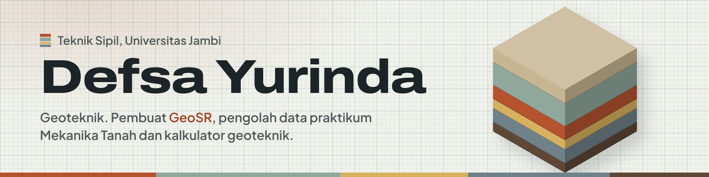

<a href="https://defsayurinda.github.io/">
  <picture>
    <source media="(prefers-color-scheme: dark)" srcset="assets/banner-gelap.png">
    
  </picture>
</a>

Mahasiswa Teknik Sipil Universitas Jambi dengan minat utama geoteknik. Saya membuat **GeoSR** (Geotechnical Soil Report): pengolah data praktikum Mekanika Tanah, kalkulator geoteknik, dan latihan soal yang menampilkan langkah hitungan dan sumber rumusnya.

**[Buka GeoSR](https://defsayurinda.github.io/)** · [Praktikum](https://defsayurinda.github.io/praktikum/) · [Kalkulator](https://defsayurinda.github.io/alat/) · [Latihan soal](https://defsayurinda.github.io/latihan/) · [Tentang saya](https://defsayurinda.github.io/pembuat/)

Klik judul di bawah untuk membuka daftarnya.

<b>Alat praktikum Mekanika Tanah</b>

Formulir seperti lembar data laboratorium, langkah hitungan, grafik, dan ekspor ke Word dan Excel.

<!-- PRAKTIKUM:MULAI -->

- **Sifat fisik:** [Kadar air](https://defsayurinda.github.io/praktikum/kadar-air/), [Berat spesifik (piknometer)](https://defsayurinda.github.io/praktikum/berat-spesifik/), [Hubungan berat–volume](https://defsayurinda.github.io/praktikum/hubungan-fase/)
- **Konsistensi dan gradasi:** [Batas Atterberg](https://defsayurinda.github.io/praktikum/atterberg/), [Batas susut](https://defsayurinda.github.io/praktikum/batas-susut/), [Analisa saringan](https://defsayurinda.github.io/praktikum/saringan/), [Analisa hidrometer](https://defsayurinda.github.io/praktikum/hidrometer/), [Klasifikasi tanah](https://defsayurinda.github.io/praktikum/klasifikasi/)
- **Kepadatan:** [Pemadatan (Proctor)](https://defsayurinda.github.io/praktikum/pemadatan/), [Kerucut pasir (sand cone)](https://defsayurinda.github.io/praktikum/sand-cone/), [CBR laboratorium](https://defsayurinda.github.io/praktikum/cbr/)
- **Permeabilitas:** [Permeabilitas tinggi tekan tetap (constant head)](https://defsayurinda.github.io/praktikum/permeabilitas-tetap/), [Permeabilitas tinggi tekan turun (falling head)](https://defsayurinda.github.io/praktikum/permeabilitas-turun/)
- **Kekuatan dan konsolidasi:** [Kuat geser langsung](https://defsayurinda.github.io/praktikum/geser-langsung/), [Kuat tekan bebas (UCS)](https://defsayurinda.github.io/praktikum/tekan-bebas/), [Konsolidasi laboratorium](https://defsayurinda.github.io/praktikum/konsolidasi-lab/)
- **Uji lapangan:** [Sondir](https://defsayurinda.github.io/praktikum/sondir/), [SPT dan log bor](https://defsayurinda.github.io/praktikum/spt/)

<!-- PRAKTIKUM:SELESAI -->

<b>Kalkulator geoteknik dan latihan soal</b>

Kolom status menunjukkan sumber rumus tiap alat.

<!-- KALKULATOR:MULAI -->

| Alat | Isi | Status rumus |
|---|---|---|
| [Kalkulator Tiang Bor N-SPT](https://defsayurinda.github.io/kalkulator/tiang-bor.html) | Hitung daya dukung aksial tiang bor dari data N-SPT dengan metode Reese & Wright (1977), lengkap dengan langkah hitungan dan asumsinya. | sumber sekunder |
| [Kalkulator Lateral Tiang Broms](https://defsayurinda.github.io/kalkulator/broms-lateral.html) | Hitung beban lateral ultimit tiang tunggal metode Broms di tanah kohesif atau nonkohesif, kepala bebas atau terjepit, dengan moda keruntuhan, panjang peralihan, dan langkah hitungan. | sumber sekunder |
| [Kalkulator Pondasi Dangkal](https://defsayurinda.github.io/kalkulator/pondasi-dangkal.html) | Hitung kapasitas dukung pondasi dangkal dengan persamaan daya dukung umum: faktor bentuk, kedalaman, dan koreksi muka air tanah, lengkap dengan langkah hitungan. | belum terverifikasi |
| [Kalkulator Penurunan Konsolidasi](https://defsayurinda.github.io/kalkulator/konsolidasi.html) | Hitung penurunan konsolidasi primer satu dimensi untuk lempung NC dan OC beserta lajunya terhadap waktu, lengkap dengan diagram e–log σ' dan langkah hitungan. | belum terverifikasi |
| [Latihan Soal Geoteknik](https://defsayurinda.github.io/latihan/) | Latihan soal geoteknik dengan angka acak dan pembahasan langkah demi langkah: sifat fisik tanah, batas Atterberg, pondasi dangkal, konsolidasi, tiang bor, tiang lateral, dan penyelidikan tanah. | belum terverifikasi |
| [Kalkulator Korelasi N-SPT](https://defsayurinda.github.io/kalkulator/korelasi-spt.html) | Koreksi N-SPT ke N60 dan (N1)60, lalu perkiraan kepadatan relatif, sudut geser, modulus elastisitas pasir, kuat geser undrained lempung, dan kecepatan gelombang geser, dengan rujukan halaman. | sumber sekunder |
| [Kalkulator Korelasi Sondir](https://defsayurinda.github.io/kalkulator/korelasi-cpt.html) | Dari qc dan fs sondir, perkiraan kepadatan relatif dan sudut geser pasir, serta kuat geser undrained, sensitivitas, OCR, rasio kompresi, dan kecepatan gelombang geser lempung, dengan rujukan halaman. | sumber sekunder |

<!-- KALKULATOR:SELESAI -->

<b>In English</b>

Civil engineering student at Universitas Jambi, Indonesia, mainly interested in geotechnical engineering. I build GeoSR: tools for soil mechanics lab data, geotechnical calculators with full step-by-step working, and practice problems. The [site](https://defsayurinda.github.io/en/) has an English home page; the tools themselves are in Indonesian.

Daftar alat diperbarui otomatis setiap hari dari repo situs.
